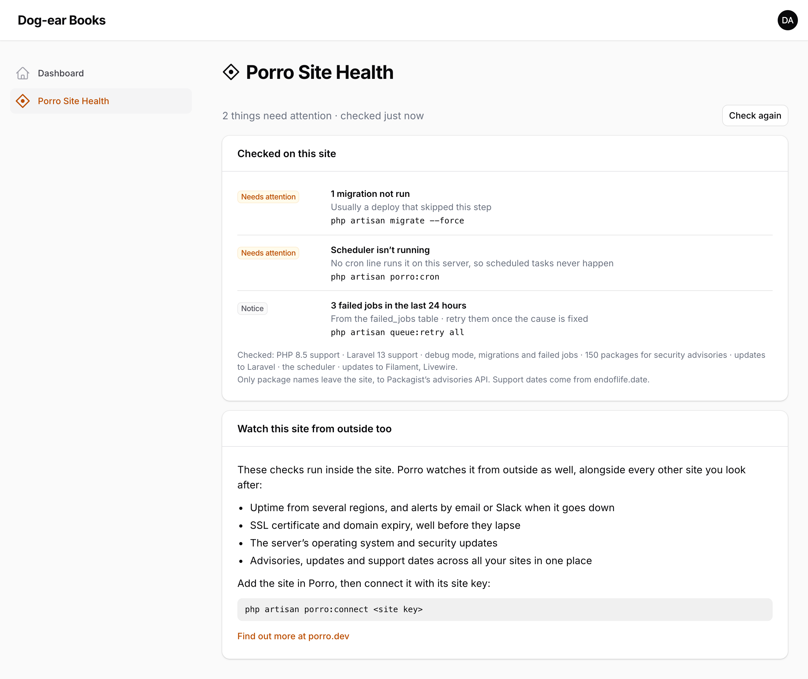
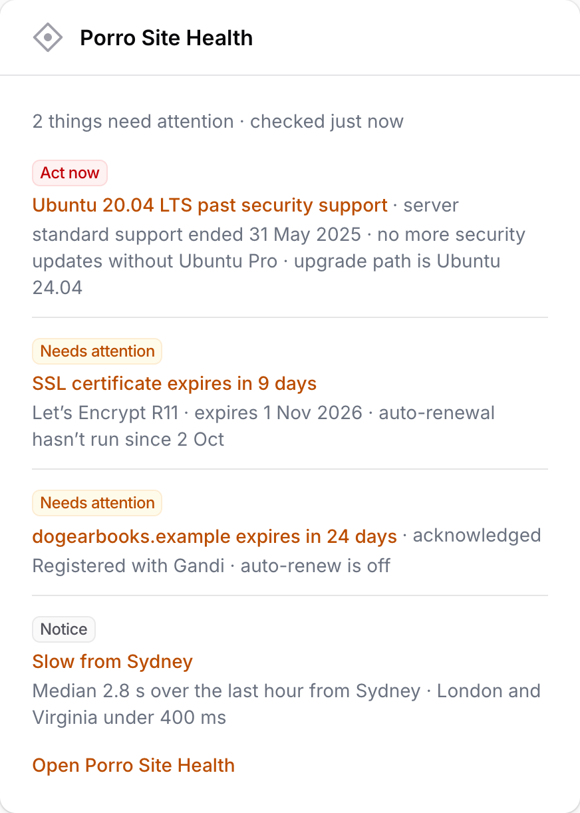
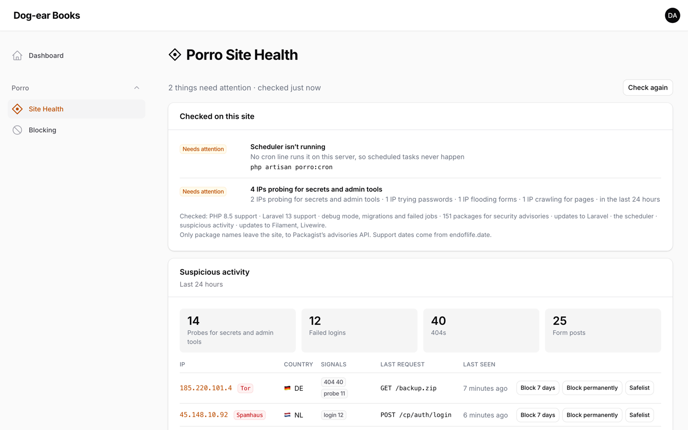
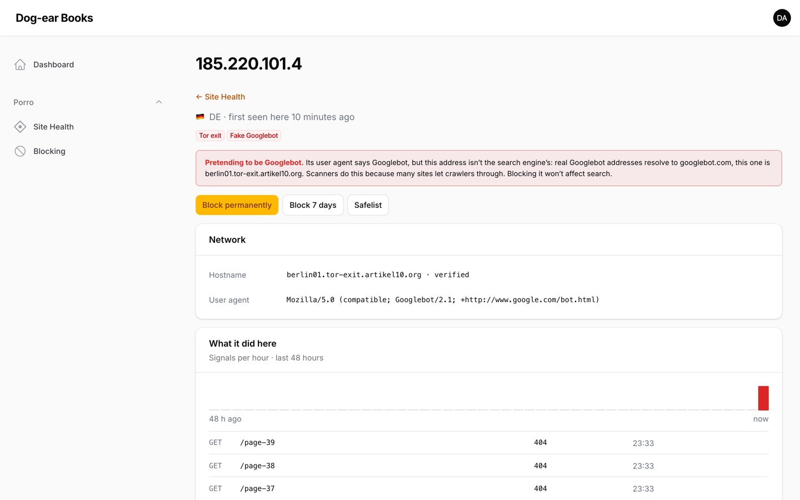
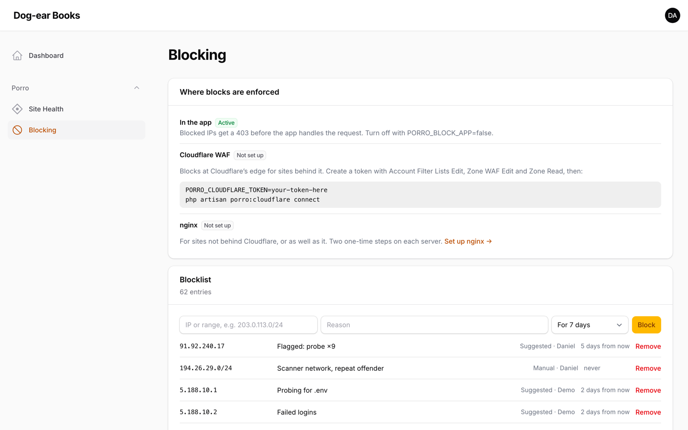
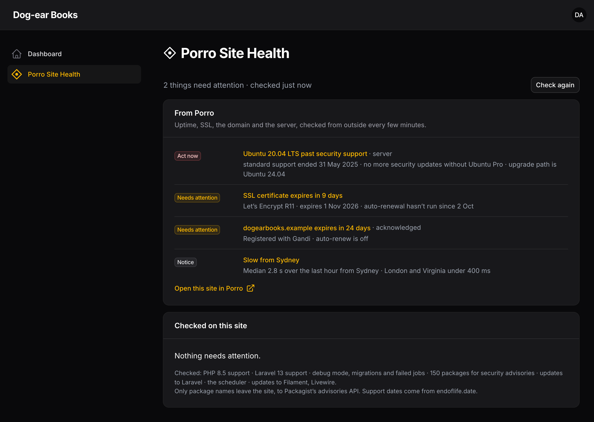

# Porro Site Health for Filament

A Porro Site Health page for Filament 3, 4 and 5 panels. It checks the app for the things that quietly go wrong between projects (security advisories in your Composer packages, PHP and Laravel versions running out of security support, Filament, Livewire and Laravel updates, a scheduler that never runs) and tells you what to do about each.

It's free and works on its own. If you use [Porro](https://porro.dev) to look after your sites, connecting it adds what can only be seen from outside: uptime, SSL certificates, domain expiry and the server's operating system.



## Install

```bash
composer require porro/filament-connector
```

Add the plugin to the panel you want it in, usually your admin panel:

```php
use Porro\Filament\PorroPlugin;

public function panel(Panel $panel): Panel
{
    return $panel
        // ...
        ->plugin(PorroPlugin::make());
}
```

That adds a **Porro** group to the navigation with **Site Health** and **Blocking**, plus a lazy-loaded dashboard widget. Run `php artisan migrate` for the blocklist tables. No assets to publish or build.



### Options

```php
PorroPlugin::make()
    ->widget(false)                 // no dashboard widget
    ->navigationGroup('Settings')   // instead of "Porro": the pages become "Porro Site Health" and "Porro Blocking"
    ->navigationSort(90)
    ->authorize(fn ($user) => $user->can('view site health'))
    ->authorizeManage(fn ($user) => $user->can('block ips'));   // who can block and safelist
```

### Who can see it

In order:

1. Your `authorize()` callback, if you give one.
2. A `viewPorroSiteHealth` gate, if your app defines one: `Gate::define('viewPorroSiteHealth', fn (User $user) => $user->is_admin);`
3. Admins, when your users have the usual markers: an `isAdmin()` or `isSuperAdmin()` method, an `is_admin` attribute, or a spatie/laravel-permission `super_admin` or `admin` role.
4. Otherwise, nobody. If your users have none of those markers, the page and widget stay hidden until you say who can see them, with a gate in a service provider's `boot()`:

```php
use Illuminate\Support\Facades\Gate;

Gate::define('viewPorroSiteHealth', fn (User $user) => in_array($user->email, ['ops@example.com']));
```

or with `authorize()` on the plugin:

```php
PorroPlugin::make()->authorize(fn (User $user) => $user->hasVerifiedEmail() && str_ends_with($user->email, '@youragency.com'));
```

To let everyone who can use the panel see it, use `->authorize(fn () => true)`. Only do that on a panel for your own team, never a customer-facing one.

The pages, the widget and **Check again** all check this on the server.

### Who can block and safelist

Whoever can see the pages, unless you narrow it. In order:

1. Your `authorizeManage()` callback.
2. Otherwise, a `managePorroBlocklist` gate.

Everyone else sees the lists but no buttons, and the server refuses their changes too.

## Suspicious activity and blocking

Free, and on the app itself. IP addresses never leave it. The rules are the [Laravel connector's](https://github.com/Porrodev/laravel-connector#suspicious-activity-and-blocking), so its README has every setting.



- **What's watched:** probes for files like `/.env`, `/.git` and `wp-login.php`, failed logins on any guard (the panel's included), bursts of 404s and form floods. Counts are kept in the cache for 48 hours, and usernames only as hashes.
- **Site Health lists the IPs worth a look,** worst first, with badges for Tor exits, Spamhaus DROP, hosting networks and research scanners, and **Block 7 days**, **Block permanently** and **Safelist** buttons. Each one asks first, in a confirmation that says what will happen and for how long.
- **Exposed files:** if `/.env` or `/.git` ever answers, that's raised as **Act now**.
- **IP details:** click an IP for its network, a reverse-DNS hostname checked both ways, what it did here over 48 hours, and a plain note when something claiming to be Googlebot or Bingbot isn't. With `PORRO_ABUSEIPDB_KEY`, a button checks AbuseIPDB; that's the one lookup that sends the IP anywhere, so it only runs when clicked.



- **The Blocking page:** where blocks are enforced, the newest of the blocklist and safelist (each searchable on its own page, 50 at a time), and what's always protected.
- **Where blocks are enforced:**
  - **In the app:** blocked IPs get a plain 403 before the app runs. On by default; `PORRO_BLOCK_APP=false` turns it off.
  - **At Cloudflare's edge:** open **Blocking → Set up Cloudflare** and follow three steps. Create a token with Zone WAF Rules: Edit and Zone: Read on the site's domain, plus Account Rule Lists: Edit on the account. Set it as `PORRO_CLOUDFLARE_TOKEN`, then press Connect (or run `php artisan porro:cloudflare connect`). It adds one rule next to your existing ones, and only production syncs. The `porro_blocklist` list belongs to the whole Cloudflare account, so every site you connect on that account shares its blocks.
  - **In nginx:** `PORRO_BLOCK_NGINX=true`, then **Blocking → Set up nginx** walks through three steps with this site's real paths and shows how far each server has got.
- **Always protected:** Cloudflare, Laravel Forge and its health checks, Google's and Bing's published crawler ranges, and private addresses can't be blocked; open each on the Blocking page to see its ranges and why. Not on Forge? `PORRO_PROTECT_FORGE=false`. Happy to block a crawler? `PORRO_PROTECT_CRAWLERS=false`. Blocks of your own IP or very wide ranges are refused too.



- **Production only:** activity is recorded in production only (`PORRO_ACTIVITY=true` to record elsewhere). Blocks apply everywhere.
- **Country:** comes from Cloudflare when the site is behind it. Otherwise it comes from [DB-IP](https://db-ip.com)'s free country file, downloaded monthly to `storage/porro`.

## What it checks

On the app itself, with no account:

| Check | How |
|---|---|
| Security advisories in `composer.lock` | [Packagist's security advisories API](https://packagist.org/apidoc#list-security-advisories), the one `composer audit` uses. Only package names are sent; versions are matched on your server. High and critical advisories show as **Act now**. |
| PHP and Laravel support | Past, or within 90 days of, the end of security support, from [endoflife.date](https://endoflife.date). A copy ships with the package for when it can't be reached. |
| Updates | Newer Filament, Livewire and Laravel releases on the major versions you run, from Packagist |
| Scheduler | Whether `schedule:run` is running, from a heartbeat the package schedules every 15 minutes, and whether the crontab has the line. `php artisan porro:cron` adds it. |
| Debug mode, migrations, failed jobs | `APP_DEBUG` on in production, migrations not run, failed jobs in the last 24 hours |
| Backups and health checks | Stale backups from `spatie/laravel-backup` and failing `spatie/laravel-health` checks, if you use them |

Results are cached for five minutes, and the public data behind them for between six hours and a day. **Check again** runs everything now.

## Connect Porro (optional)

Porro watches every site you look after from outside: uptime from several regions, SSL and domain expiry, the server's OS and security updates, with alerts by email or Slack. It's a separate service with its own account; see [porro.dev](https://porro.dev) for plans. Nothing in this package needs it, and nothing is sent to Porro until you connect. Add the site in Porro, then:

```bash
php artisan porro:connect <site key>
```

The page then shows the site's open findings in Porro alongside the checks above, each linking to Porro.



Connecting also sends Porro a signed report every 15 minutes on Laravel's scheduler: Filament, Livewire, plugin and package versions, each panel's id, path, whether it has a login and (from Filament 4) whether multi-factor authentication is required, plus the health facts above. Never content, users or settings values. Run `php artisan porro:status --json` to see exactly what would be sent, and see the [Laravel connector](https://github.com/Porrodev/laravel-connector) for config and commands.

`porro:connect` offers to add the scheduler's cron line; `php artisan porro:cron` adds it on its own.

## Requirements

- Filament 3.2, 4 or 5, Laravel 11–13, PHP 8.2+
- Outbound HTTPS to `packagist.org`, `repo.packagist.org` and `endoflife.date` (and `app.porro.dev` once connected). Without it, the checks that need them say so and the rest still run.

## Demo

[Dog-ear Books](https://github.com/Porrodev/filament-demo) is a demo app with the plugin set up and things for it to find, a stand-in Porro for the connected view, and the end-to-end checks and screenshot script behind these images. `docs/images/filament-thumbnail.png` is the plugin directory's 2560 × 1440 thumbnail.

## External requests

| To | When | What's sent |
|---|---|---|
| `packagist.org` | Advisory check, at most every 6 hours or when `composer.lock` changes | Package names from `composer.lock` |
| `repo.packagist.org` | Update check, at most twice a day per package | Nothing beyond the request |
| `endoflife.date` | Support dates, at most once a day | Nothing beyond the request |
| `app.porro.dev` | Only once connected: reports every 15 minutes, findings when the page is open (cached 5 minutes) | Signed with the site key |

## Support

Questions and bugs: [GitHub issues](https://github.com/Porrodev/filament-connector/issues). Security issues: please email security@porro.dev rather than opening an issue. We reply within one working day.

## Developing

```bash
composer install
composer test
```

## License

MIT. See [CHANGELOG.md](CHANGELOG.md) for what changed.
